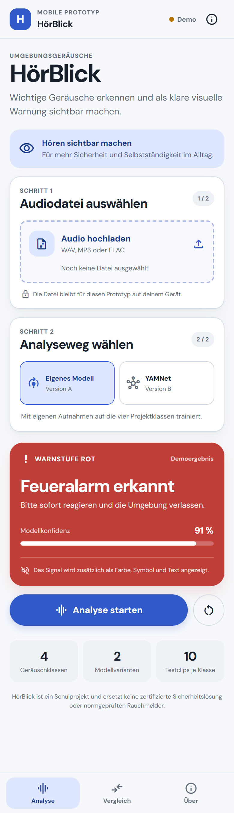

# HörBlick

HörBlick ist ein schulisches Prototyp-Projekt zur Klausurersatzleistung Informatik. Die Anwendung ordnet Umgebungsgeräusche ein und macht sicherheitsrelevante Schallereignisse für Menschen mit Hörbeeinträchtigung sichtbar.

Das Repository enthält eine eigenständige Weboberfläche, einen Python-/Streamlit-Prototyp, Trainings- und Testdaten, Modellcode sowie die Projektdokumentation. Die Anwendung ist eine Demonstration und ersetzt keine zertifizierte Warntechnik oder normgeprüften Rauchmelder.

## Projektstruktur

```text
.
├── web-prototype/       Statische HörBlick-Oberfläche
├── hoerblick/           Streamlit-App, ML-Module und Datensätze
│   ├── data/            Synthetische Trainings- und Testdaten
│   ├── docs/            Dokumentation und Reflexion
│   ├── models/          Zielordner für lokale Modellexporte
│   ├── scripts/         Datenprüfung und Training
│   └── tests/           Automatisierte Tests
└── docs/screenshots/    UI-Screenshots und PDF-Übersicht
```

## Webprototyp öffnen

`web-prototype/index.html` ist die eigenständige mobile UI-Skizze mit den drei Ansichten Analyse, Vergleich und Über. Nach dem lokalen Herunterladen genügt ein Doppelklick auf die HTML-Datei. Die Schriftart und die Material-Symbole werden über Google Fonts geladen.

Die Bildschirmansichten sind in [docs/screenshots](docs/screenshots/) dokumentiert:



## Streamlit-App starten

Voraussetzung ist Python 3.11 oder neuer.

```powershell
cd hoerblick
python -m venv .venv
.venv\Scripts\Activate.ps1
python -m pip install -r requirements.txt
streamlit run app.py
```

Die optionalen Modellabhängigkeiten für TensorFlow, TensorFlow Hub und lokales Training stehen in `hoerblick/requirements-ml.txt`.

Ohne exportierte Modell-Datei läuft die Streamlit-App im klar gekennzeichneten Demo-Modus. Das eigene Modell erwartet einen Teachable-Machine-Export in `hoerblick/models/model_a/` mit `keras_model.h5` und `labels.txt`.

Der eingecheckte Modellcheck erreicht mit einem kleinen realen Testsatz 25 % Accuracy und erkennt alle Klassen fälschlich als Alarm. Er belegt den Ablauf, nicht die Qualität des Modells. Die vollständigen Messwerte stehen in [`hoerblick/models/model_a/metrics.json`](hoerblick/models/model_a/metrics.json) und die Einordnung im [Trainingsprotokoll](hoerblick/docs/trainingsprotokoll.md).

## Daten und Modi

Der eingecheckte Datensatz besteht aus 48 synthetischen Trainings- und 40 synthetischen Testdateien aufgeteilt auf die Klassen `alarm`, `siren`, `doorbell` und `background`. Die Töne dienen der Prüfung der Ordnerstruktur und des technischen Ablaufs. Für eine belastbare Bewertung sind echte, unterschiedlich aufgenommene und lizenzrechtlich geklärte Geräusche erforderlich.

Die Datensätze sind nach `train` und `test` getrennt. Herkunft und Lizenz jeder Datei stehen in [`hoerblick/data/metadata.csv`](hoerblick/data/metadata.csv). Details beschreibt [`hoerblick/data/README.md`](hoerblick/data/README.md).

## Prüfen und trainieren

Aus dem Ordner `hoerblick`:

```powershell
python scripts/check_dataset.py
python -m unittest discover -s tests -v
python scripts/make_demo_dataset.py
```

Das lokale Training erwartet die Quelldateien in `audio-source/` mit den Unterordnern `Feueralarm`, `sirenen`, `Klingeln` und `Hintergrund`. Der Pfad kann mit `--source` geändert werden. Das Training benötigt die Abhängigkeiten aus `requirements-ml.txt` und scikit-learn.

Reale Audioaufnahmen bleiben außerhalb von Git. Das Training übernimmt später die jeweils geklärten Dateien aus dem lokalen Quellordner und dokumentiert deren Herkunft in der Metadatendatei. Der kleine Modellcheck und seine Messwerte werden mit versioniert.

## Dokumentation

- [Projektdokumentation](hoerblick/docs/dokumentation.md)
- [Trainingsprotokoll](hoerblick/docs/trainingsprotokoll.md)
- [KI-Reflexion](hoerblick/docs/ki_reflexion.md)
- [UI-Screenshots](docs/screenshots/HoerBlick-UI-Screenshots.pdf)

## Technische Hinweise

Der Streamlit-Prototyp zeigt eine klare Warnhierarchie mit Farbe, Text und Symbol. Die synthetische Quelle alarmiert bewusst, damit das Interface auch ohne Audioausgabe verständlich bleibt. Das Repository speichert bewusst keine erzeugten Modellgewichte, Zugangsdaten oder lokalen virtuellen Umgebungen.

Die verwendeten Webfonts und Material Symbols werden von Google Fonts geladen. YAMNet stammt aus TensorFlow Hub und steht unter Apache-2.0.
